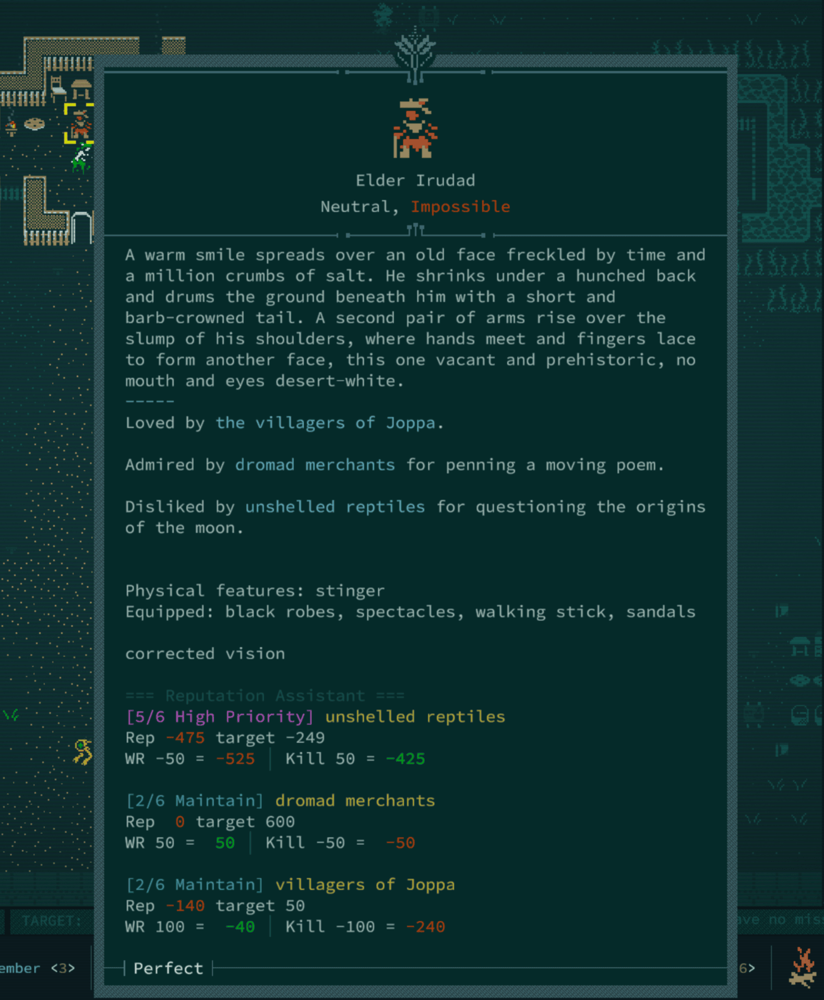
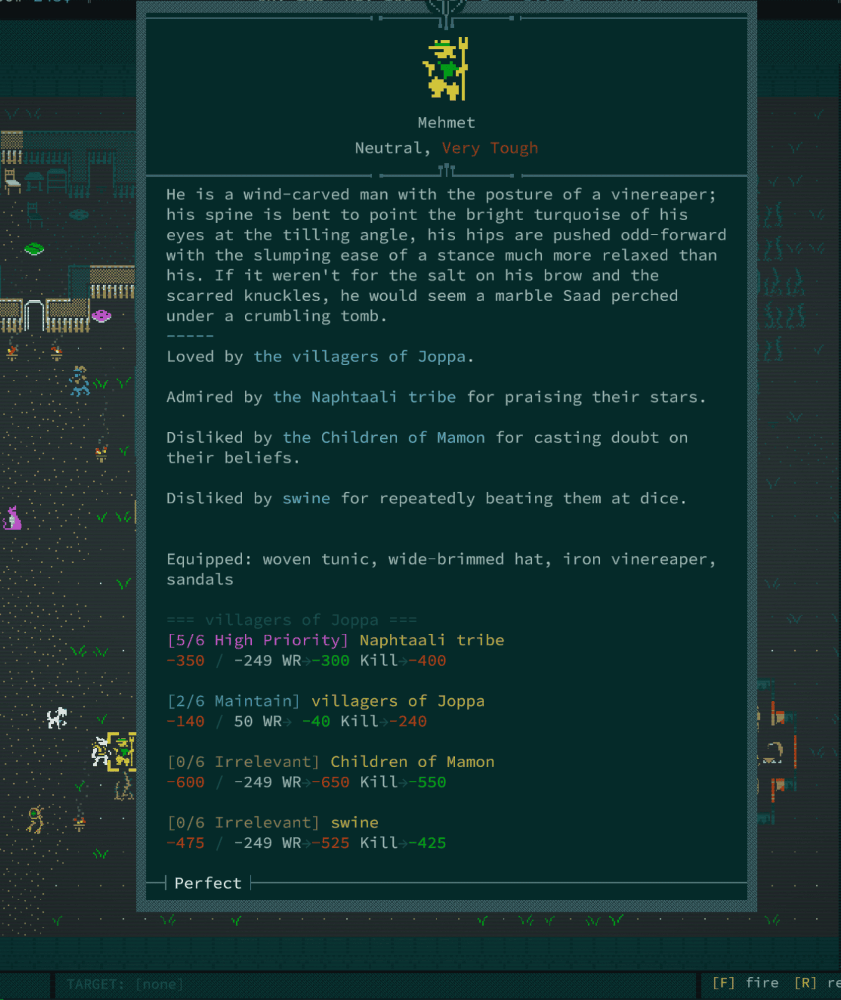
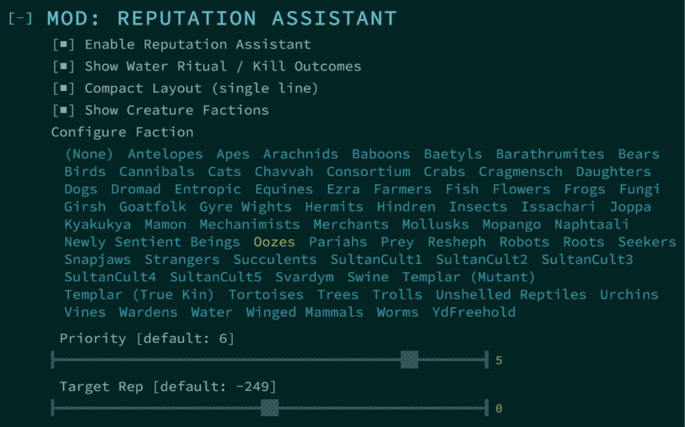

# Reputation Assistant 

A [Caves of Qud](https://store.steampowered.com/app/333640/Caves_of_Qud/) mod. Look at a legendary, or anyone whose death or Water Ritual changes your reputation, and the popup lists each faction involved: how much it matters, where you stand, and what a Water Ritual or a kill would do.

I made it because I kept opening the faction list before every Water Ritual.

Get it on the [Steam Workshop](https://steamcommunity.com/sharedfiles/filedetails/?id=3664930126).

  

<sub>Screenshots are from 1.2. The Water Ritual and kill numbers changed in 1.6.</sub>

**Spoilers:** the priorities come from A-F-F-I-N-E's [reputation guide](https://www.qudzoo.com/advice/reputation) on qudzoo.com. They're opinionated and give away which factions matter later, so maybe leave this off for your first few runs.

## Reading it

```txt
=== Reputation Assistant ===
  [5/6 High Priority] Naphtaali tribe
    Rep -350  target -249
    WR +100 = -250  │  Kill -220 = -570
```

The tag is the guide's priority, from 0 (irrelevant) to 6 (critical). The target is the reputation you want to stay at or above. Your rep is green at or above the target. An outcome is green if it reaches the target or at least moves toward it, and red otherwise.

The game rolls each kill's reputation change, so kill numbers show the worst roll. Water Ritual numbers are for a plain ritual: Tactful, a social co-processor or a good formal ritual add a bit more. The WR part goes away once you've done the ritual. If you're water-bonded, you get a reminder that killing them costs about 100 reputation with every faction.

## Options

Everything is under **Mod: Reputation Assistant** in the options menu. You can hide the WR and kill line, squeeze each faction onto one line, or show the creature's own factions as the title.

**Configure Faction** changes the priority and target of each listed faction. Foxen and Snailfolk from the Diaspora DLC have their own entries. **Other factions** is one setting for every faction without its own entry, like villages and factions added by other mods.

It works with existing saves, and you can remove it any time: it only adds text to the look popup.

It pairs well with [You Spot a Legendary!](https://steamcommunity.com/sharedfiles/filedetails/?id=3507307896) by Cattlesquat, which tells you when a legendary shows up.

## How it works

A Harmony postfix on `Description.GetLongDescription` reads `GivesRep.relatedFactions`, `GivesRep.GetLovedFactions()` and the creature's own factions. It then applies the game's kill and Water Ritual formulas. Faction defaults live in [`Options.xml`](ReputationAssistant/Options.xml).

[MIT](LICENSE)
