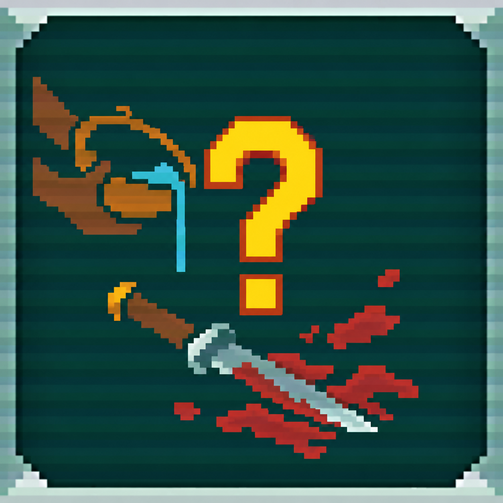
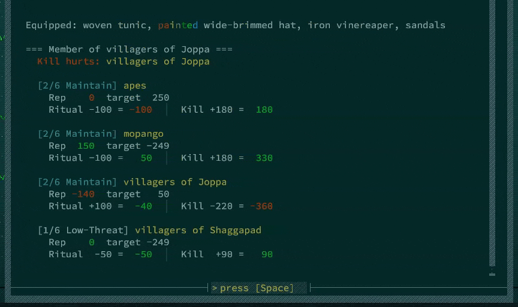

# Reputation Assistant 

A [Caves of Qud](https://store.steampowered.com/app/333640/Caves_of_Qud/) mod. Look at anyone whose death or Water Ritual changes your reputation, and the popup shows each faction involved, how much it matters, and what a ritual or a kill would do.

**1.7 is a new version that works with the latest Caves of Qud (2.0.211.56), with a big code cleanup and a clearer, easier-to-read popup. Sorry the mod didn't work for a while.**

Get it on the [Steam Workshop](https://steamcommunity.com/sharedfiles/filedetails/?id=3664930126).

[Watch the in-game preview with music](https://cdn.jsdelivr.net/gh/ReynkeDeVos/CoQ_MOD_ReputationAssistant@v1.7.1/promo/assets/promo_v1.7.mp4). The music is "Live and Drink" by Craig Hamilton, from the Caves of Qud soundtrack, and isn't covered by this repo's MIT license.

- The line under the title lists the factions a kill would hurt, most important first: it lowers your reputation there and leaves it below the target.
- The tag is the faction's priority, from 0 to 6. Try to stay at or above the target.
- Green reaches the target or moves toward it. Red leaves you below it.
- Kills show the worst roll. Water Ritual numbers are for a plain ritual.

**Spoilers:** the priorities come from A-F-F-I-N-E's [reputation guide](https://www.qudzoo.com/advice/reputation) and give away which factions matter later.

Change priorities, targets and the layout under **Mod: Reputation Assistant** in the options. It works with villages and with factions from other mods or DLC, and it's safe to add or remove mid-game.

[MIT](LICENSE)
