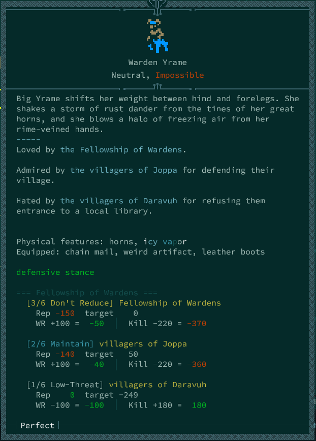

# Reputation Assistant 

A [Caves of Qud](https://store.steampowered.com/app/333640/Caves_of_Qud/) mod. Look at anyone whose death or Water Ritual changes your reputation, and the popup shows each faction involved, how much it matters, and what a ritual or a kill would do.

1.6 works with the latest Caves of Qud (2.0.211.56). Older versions of this mod showed the wrong kill and Water Ritual numbers.

Get it on the [Steam Workshop](https://steamcommunity.com/sharedfiles/filedetails/?id=3664930126).

- The tag is the faction's priority, from 0 to 6. Try to stay at or above the target.
- Green reaches the target or moves toward it. Red leaves you below it.
- Kills show the worst roll. Water Ritual numbers are for a plain ritual.

**Spoilers:** the priorities come from A-F-F-I-N-E's [reputation guide](https://www.qudzoo.com/advice/reputation) and give away which factions matter later.

Change priorities, targets and the layout under **Mod: Reputation Assistant** in the options. It works with villages and with factions from other mods or DLC, and it's safe to add or remove mid-game.

[MIT](LICENSE)
